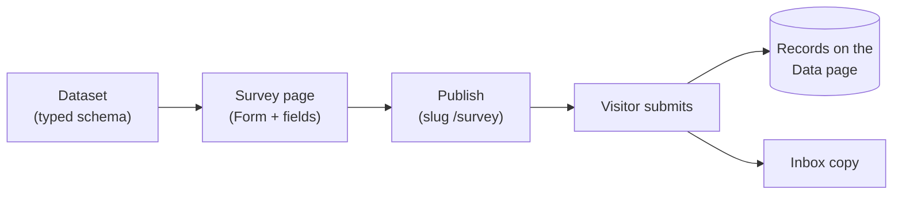

# Build & publish a survey

This walkthrough strings together datasets, the Besigner's form elements, and
publishing into one loop: **model the responses → design the survey → publish →
collect**. By the end you have a live survey page whose submissions land in a
typed dataset you can filter, search, and export.

<!-- regenerate: node tools/e2e/capture-docs-shots.mjs -->

:::info Plan availability
Forms and the inbox are available on every plan. Writing submissions into a
**dataset** needs the data store, which unlocks on **Starter** and above.
:::

## 1. Create the dataset

Datasets belong to your organization, so every site can share them. Open the
organization **Data** page (or any site's Data page — both edit the same data).

1. Choose **Add dataset**. In the **New dataset** dialog give it a **Name**
   (say `Survey responses`) and a comma-separated list of **Fields**
   (`satisfaction, visit, topics, comments`) — at least one, or **Create** stays
   disabled. Create it.
2. Select your new dataset in the **Dataset** dropdown and open **Schema**.
   The **Schema** dialog lists each field with its display name, generated
   field id, and a type chip.
3. Use **Add field** / **Edit** to type the fields properly:
   - `satisfaction` → type **Integer**. A form stores every value as text, so the
     rating lands as `"4"`; the Data page's `=` filter still matches it as the
     number 4.
   - `visit` → type **Text** (one radio choice).
   - `topics` → type **Text** (ticked checkboxes arrive joined with `, `).
   - `comments` → type **Text**.
4. **Save schema**.

Each field's **Display name** is what you see in dialogs and table headers; the
**field id** next to it (a slug generated once from the display name) is the
stable key records store values under — the key `{{item.fieldId}}` bindings
reference, and what the **Maps to schema field** picker on a form's input stores.
Renaming the display name later never changes the id.

:::tip Model first
A clean schema now makes everything downstream typed: the record editor renders
the right input per field and imports are validated. Form submissions are the
exception — they are stored as text without validation, so a submitted value can
disagree with its field's type. See the [datasets deep-dive](datasets-and-schema.md)
for the full type system.
:::

## 2. Add a page for the survey {#2-add-a-screen-for-the-survey}

1. Go to **Pages** and choose **New page**.
2. Title it `Survey` and give it the slug `survey` — that becomes its public
   URL path (`https://your-site/survey`).
3. Open it in the **Besigner**.

## 3. Insert a Form from the element picker

With the page open, add the form:

1. In the Elements panel choose **Add Element** (or right-click a node and pick
   **Add element**). The **Choose element** picker opens, grouped by category.
2. Expand the **Forms** group. It holds the **Form** container, the ready-made
   field presets (**Text field**, **Email field**, **Message field**, **Dropdown
   field**, **Radio choice field**, **Checkbox**, **Rating field**, **Helper Text**),
   the **Contact Form** and **Marketing consent** presets, and the separate elements
   those presets are built from.
3. Insert a **Form**. Then, with the Form selected, insert one preset per question:
   - a **Rating field** for satisfaction,
   - a **Radio choice field** for how often they visit,
   - a **Form Control** holding three **Checkbox** presets, for what to improve,
   - a **Message field** for comments.

## 4. Configure the fields

Each preset is a few separate elements: a **Form Control** frame holding a
**Form Label** (the visible question) and the element the visitor answers with —
a **Rating**, a **Radio Group** of **Radio**s, **Checkbox**es or an **Input**.
Select a piece in the canvas or the Hierarchy and set it in the inspector:

| Setting | On | What it does |
| --- | --- | --- |
| **Text** | Form Label | The question the visitor reads ("How satisfied are you?"). |
| **Field name** | Rating, Radio Group, Checkbox, Input, Select | The key the answer is stored under in submissions (and in the inbox copy). |
| **Maps to schema field** | Rating, Radio Group, Checkbox, Input, Select | Which of the dataset's schema fields this answer is stored under. The dropdown lists the fields of the dataset chosen on the Form (see step 5) and stores the stable **field id**, so renaming the field later never breaks the mapping. Left on **None**, the answer matches a dataset field by its Field name instead. |
| **Value** | Radio, Checkbox | What is sent when this choice is picked or ticked. |
| **Text** | Choice Label | The words beside a Radio or Checkbox; clicking them ticks it. |
| **Placeholder** | Input, Select | An optional gray hint inside the empty input ("you@company.com"). It is not a label — it disappears as soon as someone types, so keep the Form Label. |
| **Required?** | Input, Select, Checkbox, Radio | Whether it must be answered before the form sends. |

:::tip Pick the dataset first
"Maps to schema field" lists the fields of whichever dataset the **Form** is
pointed at — set the Form's **Write to dataset** (step 5) before mapping the
fields, or the dropdown reads *No dataset selected on the form*.
:::

For this survey:

1. **Rating field** — Form Label "How satisfied are you?"; select the **Rating**
   and set **Field name** `satisfaction` and **Maps to schema field**
   *Satisfaction*. The stars submit their count (`4`).
2. **Radio choice field** — Form Label "How often do you visit?"; select the
   **Radio Group** and set **Field name** `visit` and **Maps to schema field**
   *Visit*. Set the three Choice Labels' **Text**, and their Radios' **Value**,
   to `First time`, `Monthly` and `Weekly`.
3. **Checkboxes** — a **Form Control** with the Form Label "What should we
   improve?" and three **Checkbox** presets inside it. Give each **Checkbox** the
   same **Field name**, `topics`, and **Maps to schema field** *Topics*, and the
   Values `Products`, `Support` and `Pricing` (with the same words as their Choice
   Label's Text). Boxes sharing a Field name are one question: visitors can tick
   several, and the submission joins them with `, `.
4. **Message field** — Form Label "Anything else?"; select the **Input** and set
   **Field name** `comments` and **Maps to schema field** *Comments*.

To restyle any piece — the stars, the box comments are typed in, the question
text — select it and use the **Styles** panel. See
[Style a field](../content-and-data/forms/overview.md#style-a-field).

## 5. Point the form at the dataset

Select the **Form** container itself and fill its properties:

- **Form name** — identifies the form in your submissions inbox
  (`Visitor survey`).
- **Write to dataset** — pick `Survey responses` from the dropdown, which
  lists your organization's datasets by display name. The form stores the
  dataset's **id**, so renaming the dataset later never breaks the binding.
  Submissions append a record; the inbox always keeps its own copy either way.
- **Submit label** — the button text (defaults to **Send**).
- **Success message** — shown in place of the form after a successful submit.

:::info Rename-safe by id
Both pickers bind by stable id: the Form stores the dataset's document id and
each field's "Maps to schema field" stores the model field id. Rename the
dataset or its fields freely — records keep landing. Unmapped values still
match schema fields **by name** (field name = field id); values that match
nothing are dropped from the record (the inbox copy still has everything).
Forms built before the pickers keep working through their stored dataset
name — shown as **Write to dataset (legacy name)** until you pick the dataset
above and clear it.
:::

## 6. Publish

Click **Publish** in the Besigner's top-right (it flips to **Unpublish** once
live). If the page has no URL path yet you're prompted to set one first. The
survey is now served at `/survey` on your site's domain.

## 7. Watch responses arrive

Every submission does three things:

- appends a **record** to `Survey responses` — the Data page updates live;
- files an **inbox copy** under the form's name (see
  [Forms & lead capture](../content-and-data/forms/overview.md));
- fires the `formSubmission` automation event, so
  [workflows and actions](../marketing-and-automation/workflows-and-actions/overview.md)
  can react (send a thank-you alert, notify your team, write other datasets).

On the Data page, use **Filters** (`satisfaction` `=` `5`) or **Search** (a word from
the comments) to narrow the records. Both reach every record in the dataset, not only the
page on screen; a number field offers `=` but no ranges, and the column headers don't
sort. See [Filter and search the records](../content-and-data/datasets/overview.md#filter-records).
Download the records with **Export**, which lets you pick the fields and the format
(CSV, JSON or NDJSON) — see [Import & export](../content-and-data/datasets/import-export.md).

:::tip Chart it
Bind a container's **Repeat over dataset** to `Survey responses` and reference
`{{item.satisfaction}}` inside it to render responses back onto a
(members-only?) results page. The [deep-dive](datasets-and-schema.md#repeatables)
covers repeatables.
:::

## Related

- [Datasets & schema deep-dive](datasets-and-schema.md)
- [Forms & lead capture](../content-and-data/forms/overview.md)
- [Publish your first page](../getting-started/publish-your-first-screen.md)
- [Workflows & actions](../marketing-and-automation/workflows-and-actions/overview.md)
