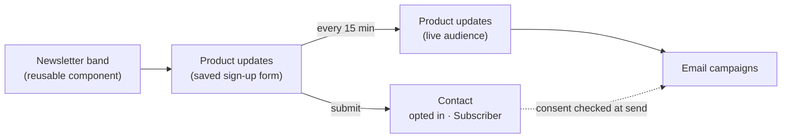

# Build a newsletter sign-up band

This walkthrough builds a full-width "Get product updates" band from parts you
already have. Each part does one job:

- A **saved form** collects the address. It holds two elements, an **Input** and
  a **Button**, and it is set up as a **sign-up form**, so submitting it records
  the person's opt-in.
- A **live audience** picks up everyone who submits that form.
- A **reusable component** draws the band and places the form in it. Every
  page that shows the band uses this one component.

Everything is done by clicking. Every color, gap and corner comes from your
theme through the Besigner's **Styles** panel, so the band follows your theme,
and you never type code.

<!-- regenerate: node tools/e2e/capture-docs-shots.mjs --only=newsletter -->

## Why not the Newsletter signup block?

The **Newsletter signup** element in the Commerce group is one fixed piece: a
heading, a small outlined field and a primary button. It works, but it cannot
look like your design. Building the band from separate elements gets you:

- **Your design.** The field and the button are separate elements, each with
  the whole Styles panel, at every screen size.
- **One place to change it.** Change the component once and every page that
  uses it updates. The same goes for the form.
- **Theme colors and spacing.** Every color picker offers your theme's colors,
  and every spacing field offers its spacing steps, so the band follows a theme
  change, or another site's theme, with nothing to re-pick.
- **An audience by rule.** The audience fills itself from the form's
  submissions.

:::note What the block does that this does not
The block sends a **confirmation email** when the site
[asks new subscribers to confirm](../marketing-and-automation/email-campaigns/overview.md#double-opt-in).
A saved sign-up form records the opt-in at once and sends no confirmation. If
your site requires confirmation, keep using the block for now.
:::

## 1. Create the saved form

1. Open your site's **Forms** tab and choose **Create Form**.
2. In **Create new form**, enter a **Display name**: `Product updates`. Choose
   **Next**.

You land on the form's own page. Remember the display name. The audience in
step 5 finds people by it, so renaming the form later means updating the
audience too.

## 2. Add an Input and a Button

Choose **Edit in besigner** on the form's page. The form's own design opens
with an empty **Form** at its root. Select the Form, choose **Add Element**,
and from the **Forms** group insert an **Input**. Then, from the **Input**
group, insert a **Button** after it.

Select the **Input** and set its **Attributes**:

| Attribute | Value | Why |
| --- | --- | --- |
| **Field name** | `email` | The key the address is stored under. |
| **Type** | **Email** | The browser checks it is an address, and phones show the email keyboard. |
| **Placeholder** | `you@company.com` | The gray hint inside the empty field. |
| **Required?** | On | No empty sign-ups. |
| **Size** | **Small** | 40px tall, to sit beside the button. |
| **Accessible label** | `Email address` | The field's name for screen readers, since the band shows no label above it. |

Select the **Button** and set its **Text** to `Subscribe` and its **Type** to
**Submit**. A Submit button inside a form is the form's button: the Form's own
built-in button steps aside, and this one sends the address.

Finally select the **Form** itself and set **Success message** to `Thanks —
you're on the list. No spam, ever.` It replaces the form after a successful
sign-up.

## 3. Style the form with the Styles panel

Each element is styled on its own, in the **Styles** tab. Pick colors from the
**theme colors** each color picker offers and spacing from the theme's
**spacing steps**. See
[Responsive styling](../building-sites/besigner/responsive-styling.md).

**The Form: stacked on phones, one line from tablet up.** Select the Form and
open **Flexbox & Grid**:

1. With the toolbar's breakpoint picker on **Fluid Responsive** (every screen
   size), set **Flex direction** to *column*, **Justify content** to *center*
   and **Gap** to **Small**. Leave **Align items** unset, so the field and button
   stretch to full width on a phone.
2. Switch the breakpoint picker to **SM – Tablet**. The panel now reads
   *Styling breakpoint: SM*. Set **Flex direction** to *row* and **Align items**
   to *center*. From tablet width up, the field and button share one line.
3. Back on **Fluid Responsive**, in **Sizing**, set **Width** to `100` %.

See [Style per breakpoint](../building-sites/besigner/responsive-styling.md#style-per-breakpoint).

**The Input: a white field with no outline.** Select the Input:

- **Colors**: **Background Color** = `common.white`, **Text Color** =
  `grey.900`.
- **Borders & Shadows**: **Border Color** = `common.white`, so the outline
  disappears into the field, and **Corner Radius** = **Slightly rounded**.
- **Sizing**: at **SM – Tablet**, **Width** = `320` px. On phones it stays full
  width.

The outline you see is the Input's own border, so Border Color and Corner
Radius change it directly. A focus ring still appears while someone types.

**The Button: dark, with a lighter shade on hover.** Select the Button:

- **Colors**: **Background Color** = `grey.900`, **Text Color** =
  `common.white`.
- In the spacing ring, **Padding**: Top and Bottom **Extra small**, Left and
  Right **Medium**.
- Switch the state chips from **Default** to **Hover**, and set **Background
  Color** = `grey.800`. Switch back to **Default**. See
  [Style hover, focus and other states](../building-sites/besigner/responsive-styling.md#interaction-states).

When the form looks right, publish it from the top-right save button →
**Save & publish**, or from the form page's **Versions** card. See
[Versions](../content-and-data/forms/overview.md#form-versions).

## 4. Make it a sign-up form

On the form's page, in the **CRM routing** card:

1. Leave **Also create a lead from the address someone gives this form** off.
   A newsletter reader is a subscriber, not a sales lead.
2. Turn on **This is a sign-up form: submitting it subscribes the person**.
3. Leave **Marketing consent field** on *None*. Its help text now reads "Not
   needed on a sign-up form: submitting it is the opt-in."
4. Choose **Save**.

Every submission now:

- creates or updates the person in **Contacts**,
- records their **marketing consent** for this site, and
- makes them at least a **Subscriber**. A lead or customer who signs up keeps
  their stage.

Normally submitting a form is *never* consent, and a person opts in only by
ticking a box. The switch is the one exception, and you choose it, form by form,
for a form whose only purpose is subscribing. That is why the band's copy says
plainly what the person is signing up for.

:::note Sites in a consent group
If your site [shares a consent group](../content-and-data/forms/overview.md#consent-group-disclosure),
a sign-up form records the opt-in for this site alone.
:::

## 5. Create the live audience

1. Open your site's **Emails** tab → **Audiences** and choose **Create
   audience**. Name it `Product updates` and create it.
2. On the audience's page choose **Edit list**.
3. Set **Membership** to **Live — keeps growing**.
4. Set **People from** to **Form submissions**, and **Submitted form** to
   `Product updates`, the form's display name from step 1.
5. Choose **Save**. The **This audience** box reads *Submitted any of: Product
   updates.*

The audience refreshes about **once an hour** (sooner right after you save
it). Its chip reads *Rule · not yet evaluated* until the first refresh. After that, everyone who has
submitted the form is on it. **Submitted form** matches the form's display name
exactly (ignoring case), so if you rename the form, update the audience too.

:::info The Consent column on a live audience
Matching a rule is not an opt-in, so a live audience records no consent of its
own. For the people it added, the **Consent** column shows the opt-in on their
**contact** (step 8), and that is the same opt-in a campaign checks before it
sends. Someone who signed up through the form reads **Opted in**. See
[Lists built from a rule](../marketing-and-automation/email-campaigns/overview.md#lists-built-from-a-rule).
:::

## 6. Build the band as a reusable component

1. Open **Components** → **Create Component**. Under **Where will you use it?**
   choose **On pages**, name it `Newsletter band`, and choose **Next**. Then
   **Edit in Besigner**.
2. Give it two text **properties** so each page can change the words. Choose
   **File → Properties…** → **Add property**:

   | Name | Type | Label | Default |
   | --- | --- | --- | --- |
   | `heading` | Text | Heading | `Get product updates` |
   | `description` | Text | Description | `New features, guides, and product news — straight to your inbox. No spam.` |

   Choose **Save properties**.

   

3. Build the band from the **Choose element** picker:
   - a **Section**: the band itself. Set its **Accessible label** to
     `Newsletter sign-up` so screen readers can find it.
   - inside it, two **Typography** elements:
     - The first one's text is the **heading** property. Use the text field's
       `{}` button and pick **heading** from its **Properties** group. Set
       **Variant** to **Heading 4** and **Component** to `h2`.
     - The second one's text is the **description** property, picked the same
       way, with **Variant** set to **Body 1**.

     See [Insert a variable](../building-sites/bindings/overview.md#insert-a-variable).
   - a **Form**, from the **Forms** group. Pick `Product updates` under
     **Form**. The band now draws that form's field and button, styled as you
     styled them.
4. Style the **Section**:
   - **Colors**:
     - **Background Fill** = *Linear gradient*. Set the **Angle** to `243`, and
       bind its two color stops to the theme's **Secondary** and **Primary**
       colors. See
       [Gradient backgrounds](../building-sites/besigner/responsive-styling.md#gradient-backgrounds).
     - **Text Color** = `common.white`. The heading and copy inside inherit it.
   - **Flexbox & Grid**: **Flex direction** *column*, **Align items** *center*,
     **Gap** **Small**.
   - **Typography**: **Text Alignment** *center*.
   - In the spacing ring, **Padding**: Top and Bottom **Huge**, Left and Right
     **Medium**.

   

   Because the gradient's stops are theme colors, each site that places the
   band shows it in that site's own colors.

5. Give the two Typography elements a little polish:
   - **The heading:** **Typography** → **Font Weight** = **Bold**.
   - **The description:** **Opacity** `0.92` and **Max Width** `600` px, so the
     line wraps comfortably on wide screens.
6. Publish the component: the top-right save button → **Save & publish**. Every
   page using it refreshes at once.

## 7. Place the band on your pages

On any page, choose **Add Element**. Your saved components are under **Your
components**. Insert **Newsletter band**.

With it selected, the **Attributes** panel shows **Heading** and
**Description**, with the defaults as their starting text. Change them on this
page, or leave them to follow the component. Then publish the page. See
[Publish & roll back](../building-sites/screens-and-layouts/versions-and-publishing.md#publish--roll-back).

To change the band everywhere, edit the **component**, never one page's copy.
See [Change it on this page only](../building-sites/besigner/reusable-components.md#override-an-attribute-on-one-instance)
for the rare page that needs to differ.

## 8. Check it on the live site

Open the published page. On a wide screen the field and button share a row.
On a phone they stack at full width:

Sign up with an address of your own, then open **CRM → Contacts** and the
contact. Check two things:

- The **Stage** chip reads **Subscriber**.
- In the **Relationship** card, **Marketing email** reads **Opted in ·
  recorded** with the date. Its timeline shows *Submitted "Product updates"*.

Within about an hour the address also appears on the **Product updates**
audience, with **Opted in** in its **Consent** column. It is ready for your next
[email campaign](../marketing-and-automation/email-campaigns/overview.md).

## Troubleshooting

| What you see | Why, and what to do |
| --- | --- |
| The audience stays empty | Wait for the hourly refresh. Then check that **Submitted form** matches the form's **Display name** exactly. A rename breaks the match. |
| The contact has no opt-in | The sign-up switch was off, or not saved, when they submitted. Turn it on and **Save**. It applies to new submissions, not past ones. |
| The field and button stack on a wide screen | **Flex direction** *row* is set at the wrong breakpoint. Select the saved form's **Form**, switch the breakpoint picker to **SM – Tablet**, and check Flexbox & Grid. Then publish the form. |
| Two buttons show | The Button's **Type** is not **Submit**. Only a Submit button replaces the form's built-in one. |
| The band shows the wrong colors | Its gradient stops are bound to your theme's **Primary** and **Secondary** colors. Change them in the theme, not in the band. |
| A gray outline shows around the field | Set the Input's **Border Color** to the same color as its **Background Color**. |

## Related

- [Forms](../content-and-data/forms/overview.md): [the field elements](../content-and-data/forms/overview.md#field-types), [placing a saved form on a page](../content-and-data/forms/overview.md#place-a-saved-form) and [CRM routing](../content-and-data/forms/overview.md#form-crm-routing)
- [Reusable components](../building-sites/besigner/reusable-components.md): [properties](../building-sites/besigner/reusable-components.md#properties) and [publishing](../building-sites/besigner/reusable-components.md#save-then-publish)
- [Responsive styling](../building-sites/besigner/responsive-styling.md): [per-breakpoint styles](../building-sites/besigner/responsive-styling.md#style-per-breakpoint), [states](../building-sites/besigner/responsive-styling.md#interaction-states), [spacing steps](../building-sites/besigner/responsive-styling.md#spacing-steps) and [gradient backgrounds](../building-sites/besigner/responsive-styling.md#gradient-backgrounds)
- [Email campaigns](../marketing-and-automation/email-campaigns/overview.md): [email lists](../marketing-and-automation/email-campaigns/overview.md#email-lists) and [asking subscribers to confirm](../marketing-and-automation/email-campaigns/overview.md#double-opt-in)
- [Build & publish a survey](build-and-publish-a-survey.md), a sibling walkthrough with a form that writes to a dataset
