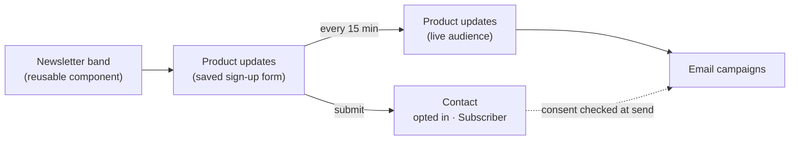

# Build a newsletter sign-up band

This walkthrough builds a full-width "Get product updates" band from parts you
already have. Each part does one job:

- A **saved form** collects the address. Its design is an email field and a
  Subscribe button, and it is set up as a **sign-up form**, so submitting it
  records the person's opt-in.
- A **live audience** picks up everyone who submits that form.
- A **reusable component** draws the band and places the form in it. Every
  page that shows the band uses this one component.

By the end you have a band you can drop on any page, styled entirely with your
theme's colors and spacing, and filling an audience you can send campaigns to.


<!-- regenerate: node tools/e2e/capture-docs-shots.mjs --only=newsletter -->



## Why not the Newsletter signup block?

The **Newsletter signup** element in the Commerce group is one fixed piece: a
heading, a small outlined field and a primary button. It works, but it cannot
look like your design. Building the band from these parts gets you:

- **Your design.** Every part is an ordinary element you can style, at every
  breakpoint.
- **One place to change it.** Change the component once and every page that
  uses it updates. The same goes for the form.
- **Theme tokens only.** Colors, spacing and type come from your theme, so the
  band follows a theme change or a different site's theme with nothing to
  re-pick.
- **An audience by rule.** The audience fills itself from the form's
  submissions, so you never paste a list id into an element.

:::note What the block does that this does not
The block sends a **confirmation email** when the site
[asks new subscribers to confirm](../marketing-and-automation/email-campaigns/overview.md#double-opt-in).
A saved sign-up form records the opt-in at once and sends no confirmation. If
your site requires confirmation, keep using the block for now.
:::

## 1. Create the saved form

1. Open your site's **Forms** tab and choose **Create Form**.
2. In **Create new form**, enter a **Display name**: `Product updates`. Choose
   **Next**.


You land on the form's own page. Remember the display name. The audience in
step 5 finds people by it, so renaming the form later means updating the
audience too.

## 2. Design the form: one email field and a button

Choose **Edit in besigner** on the form's page. The form's own design opens with
an empty **Form** at its root.

1. Choose **Add Element**. In the **Forms** group, insert a **Form Field** inside
   the Form.
2. Set the field's **Attributes**:

| Attribute | Value | Why |
| --- | --- | --- |
| **Field name** | `email` | The key the address is stored under. |
| **Type** | **Email** | The browser checks it is an address before sending. |
| **Label** | `Email address` | Keep it set, even though step 3 hides it from view. It is the field's name for screen readers. |
| **Placeholder** | `you@company.com` | The grey hint inside the empty field. |
| **Required?** | On | No empty sign-ups. |

3. Select the **Form** itself and set **Submit label** to `Subscribe` and
   **Success message** to `Thanks — you're on the list. No spam, ever.` The
   message replaces the form after a successful sign-up.


## 3. Style the form on one line

A form stacks its fields and button by default. The band puts them side by side
on wider screens and stacks them on phones. Style this **here, on the saved
form**: a page that places the form draws its styling from the form itself, so
it is set once for every page.

You set these in **Styles → Classes & custom CSS → JSS (sx)**. That tab holds an
element's whole style object, and it accepts what the other style fields cannot
express: nested selectors and per-breakpoint values. See
[Custom CSS (sx)](../building-sites/besigner/responsive-styling.md#custom-css-sx).

**The Form.** Select it, open **JSS (sx)**, paste the following, and choose
**Apply JSS**:

```json
{
  "width": "100%",
  "mt": 0.75,
  "flexDirection": { "xs": "column", "sm": "row" },
  "flexWrap": "wrap",
  "justifyContent": "center",
  "alignItems": { "xs": "stretch", "sm": "center" },
  "gap": 1.25,
  "& > :not(style) ~ :not(style)": { "mt": 0 },
  "& .MuiAlert-root": { "flexBasis": "100%" },
  "& button[type=\"submit\"]": {
    "alignSelf": "auto",
    "bgcolor": "grey.900",
    "color": "common.white",
    "px": 2.75,
    "py": 1.5,
    "&:hover": { "bgcolor": "grey.800" }
  }
}
```


What each part does:

- `flexDirection` stacks the field and button on phones (`xs`) and puts them in
  a row from tablet width (`sm`) up.
- `gap` spaces them. The `& > :not(style) ~ :not(style)` line removes the
  vertical margin the form adds between stacked children, which would otherwise
  push the button down in a row.
- `& .MuiAlert-root` gives an error or notice message its own full-width line.
- `& button[type="submit"]` styles the Subscribe button: dark fill, white text,
  a slightly larger click target, and a hover shade.

**The Form Field.** Select it and apply:

```json
{
  "width": { "xs": "100%", "sm": 320 },
  "flex": { "sm": "0 1 auto" },
  "& .MuiInputLabel-root": {
    "position": "absolute", "width": "1px", "height": "1px",
    "overflow": "hidden", "clip": "rect(0 0 0 0)", "whiteSpace": "nowrap",
    "m": 0, "p": 0
  },
  "& .MuiOutlinedInput-root": { "bgcolor": "common.white", "color": "grey.900", "borderRadius": 1 },
  "& .MuiOutlinedInput-notchedOutline": { "borderColor": "transparent" },
  "& .MuiOutlinedInput-notchedOutline legend": { "maxWidth": 0 },
  "& .MuiOutlinedInput-root.Mui-focused .MuiOutlinedInput-notchedOutline": { "borderColor": "grey.900" },
  "& .MuiOutlinedInput-input": { "py": 1.5, "px": 2 },
  "& .MuiOutlinedInput-input::placeholder": { "color": "grey.500", "opacity": 1 }
}
```

- The field is full width on phones and 320px from tablet width up.
- The label is **visually hidden, not removed**. It still names the field for
  assistive technology, which a placeholder cannot do.
- The field is white with dark text on any background, has no outline until it
  has focus, and its placeholder is a readable grey.

:::tip Why these values are tokens
Every value above is a theme token, not a hard-coded value:

- **Spacing.** A bare number such as `1.5` or `2.75` is a step on your theme's
  spacing scale. `py: 1.5` is 12px on the default 8px scale.
- **Colors.** A dotted path such as `grey.900` or `common.white` is a color from
  your theme's palette.
- **Corners.** `borderRadius: 1` is one step of the theme's corner radius.

Change the theme and the band follows. The one fixed number is the field's
320px width, a layout measurement rather than a style. See
[Spacing steps](../building-sites/besigner/responsive-styling.md#spacing-steps).
:::

When the form looks right, publish it from the top-right save button →
**Save & publish**, or from the form page's **Versions** card. See
[Versions](../content-and-data/forms/overview.md#form-versions).

## 4. Make it a sign-up form

On the form's page, in the **CRM routing** card:

1. Leave **Also create a lead from the address someone gives this form** off.
   A newsletter reader is a subscriber, not a sales lead.
2. Turn on **This is a sign-up form: submitting it subscribes the person**.
3. Leave **Marketing consent field** on *None*. Its help text now reads "Not
   needed on a sign-up form: submitting it is the opt-in."
4. Choose **Save**.


Every submission now:

- creates or updates the person in **Contacts**,
- records their **marketing consent** for this site, and
- makes them at least a **Subscriber**. A lead or customer who signs up keeps
  their stage.

Normally submitting a form is *never* consent, and a person opts in only by
ticking a box. The switch is the one exception, and you choose it, form by form,
for a form whose only purpose is subscribing. That is why the band's copy says
plainly what the person is signing up for.

:::note Sites in a consent group
If your site [shares a consent group](../content-and-data/forms/overview.md#consent-group-disclosure),
a sign-up form records the opt-in for this site alone.
:::

## 5. Create the live audience

1. Open your site's **Emails** tab → **Audiences** and choose **Create
   audience**. Name it `Product updates` and create it.
2. On the audience's page choose **Edit list**.
3. Set **Membership** to **Live — keeps growing**.
4. Set **People from** to **Form submissions**, and **Submitted form** to
   `Product updates`, the form's display name from step 1.
5. Choose **Save**. The **This audience** box reads *Submitted any of: Product
   updates.*


The audience refreshes about **every fifteen minutes**. Its chip reads *Rule ·
not yet evaluated* until the first refresh. After that, everyone who has
submitted the form is on it. **Submitted form** matches the form's display name
exactly (ignoring case), so if you rename the form, update the audience too.


:::info The Consent column on a live audience
The members table shows the consent recorded **on the membership**. A live
audience never writes consent onto its members, because matching a rule is not
an opt-in. So its rows read **No basis on record** even for people who signed up.

Their opt-in is on their **contact** (step 8), and that is what a campaign
checks before it sends. See
[Lists built from a rule](../marketing-and-automation/email-campaigns/overview.md#lists-built-from-a-rule).
:::

## 6. Build the band as a reusable component

1. Open **Components** → **Create Component**. Under **Where will you use it?**
   choose **On pages**, name it `Newsletter band`, and choose **Next**. Then
   **Open Besigner**.
2. Give it two text **properties** so each page can change the words. Choose
   **File → Properties…** → **Add property**:

| Name | Type | Label | Default |
| --- | --- | --- | --- |
| `heading` | Text | Heading | `Get product updates` |
| `description` | Text | Description | `New features, guides, and early-access news — straight to your inbox. No spam.` |

   Choose **Save properties**.


3. Build the band from the **Choose element** picker:
   - a **Section**: the band itself. Set its **Accessible label** to
     `Newsletter sign-up` so screen readers can find it.
   - inside it, two **Typography** elements. Set the first one's text to
     `{{prop.heading}}`, its **Variant** to **Heading 4** and its **Component**
     to `h2`. Set the second one's text to `{{prop.description}}` and its
     **Variant** to **Body 1**. Type the tokens, or insert them with the
     field's `{}` button from its **Properties** group. See
     [Insert a variable](../building-sites/bindings/overview.md#insert-a-variable).
   - a **Form**, from the **Forms** group. Pick `Product updates` under
     **Form**. The band now draws that form's field, button and styles.
4. Style the **Section** in **Styles → Classes & custom CSS → JSS (sx)**:

```json
{
  "backgroundImage": "linear-gradient(243deg, var(--mui-palette-primary-main) 0%, var(--mui-palette-secondary-main) 100%)",
  "color": "common.white",
  "textAlign": "center",
  "display": "flex",
  "flexDirection": "column",
  "alignItems": "center",
  "py": 8,
  "px": 3,
  "gap": 2.25
}
```


How the Section's styles work:

- **The gradient uses theme tokens.**
  `var(--mui-palette-primary-main)` and `var(--mui-palette-secondary-main)`
  are your theme's primary and secondary colors. They are filled in from the
  site's theme when the page renders, so each site's band uses that site's
  colors. Don't add a hex fallback: the theme always supplies the color.
- **Text color.** `color: common.white` makes everything inside white, the
  two Typography elements included.
- **Spacing.** `py: 8` and `px: 3` are spacing steps (64px and 24px on the
  default scale). `gap: 2.25` spaces the heading, copy and form.

Give the two Typography elements a little polish of their own:

- **The heading:** `fontWeight: bold`, `color: inherit` and `m: 0`.
- **The description:** `color: inherit`, `opacity: 0.92`, `maxWidth: sm` (the
  theme's tablet width, so the line wraps comfortably) and `m: 0`.

5. Publish the component: the top-right save button → **Save & publish**. Every
   page using it refreshes at once.

Prefer clicking to typing JSON? Most of these values have fields too:

- Spacing is in the box-model diagram.
- Colors are under **Colors**.
- Gradients are under **Background Fill**. See
  [Gradient backgrounds](../building-sites/besigner/responsive-styling.md#gradient-backgrounds).

The JSS tab is just the quickest way to set many at once, and the only way to
reach the form's inner field and button.

## 7. Place the band on your pages

On any page, choose **Add Element**. Your saved components are under **Your
components**. Insert **Newsletter band**.

With it selected, the **Attributes** panel shows **Heading** and
**Description**, with the defaults as their starting text. Change them on this
page, or leave them to follow the component. Then publish the page. See
[Publish & roll back](../building-sites/screens-and-layouts/versions-and-publishing.md#publish--roll-back).


To change the band everywhere, edit the **component**, never one page's copy.
See [Change it on this page only](../building-sites/besigner/reusable-components.md#override-an-attribute-on-one-instance)
for the rare page that needs to differ.

## 8. Check it on the live site

Open the published page. On a wide screen the field and button share a row.
On a phone they stack at full width:


Sign up with an address of your own, then open **CRM → Contacts** and the
contact. Check two things:

- The **Stage** chip reads **Subscriber**.
- In the **Relationship** card, **Marketing email** reads **Opted in ·
  recorded** with the date. Its timeline shows *Submitted "Product updates"*.


Within about fifteen minutes the address also appears on the **Product
updates** audience. It is ready for your next
[email campaign](../marketing-and-automation/email-campaigns/overview.md).

## Troubleshooting

| What you see | Why, and what to do |
| --- | --- |
| The audience stays empty | Wait for the fifteen-minute refresh. Then check that **Submitted form** matches the form's **Display name** exactly. A rename breaks the match. |
| The contact has no opt-in | The sign-up switch was off, or not saved, when they submitted. Turn it on and **Save**. It applies to new submissions, not past ones. |
| The field and button stack on a wide screen | The row layout lives on the **saved form**. Check that step 3's JSS is on the saved form's Form element, and that you published the form afterwards. |
| The band shows the wrong colors | It follows your theme's **primary** and **secondary** colors. Change them in the theme, not in the band. |
| A visible "Email address" label sits on the field | The Form Field's label styles are missing. Re-apply step 3's JSS to the Form Field. Don't clear the **Label** itself. |

## Related

- [Forms](../content-and-data/forms/overview.md): saved forms, [placing one on a page](../content-and-data/forms/overview.md#place-a-saved-form) and [CRM routing](../content-and-data/forms/overview.md#form-crm-routing)
- [Reusable components](../building-sites/besigner/reusable-components.md): [properties](../building-sites/besigner/reusable-components.md#properties) and [publishing](../building-sites/besigner/reusable-components.md#save-then-publish)
- [Responsive styling](../building-sites/besigner/responsive-styling.md): [per-breakpoint styles](../building-sites/besigner/responsive-styling.md#style-per-breakpoint), [spacing steps](../building-sites/besigner/responsive-styling.md#spacing-steps) and [custom CSS (sx)](../building-sites/besigner/responsive-styling.md#custom-css-sx)
- [Email campaigns](../marketing-and-automation/email-campaigns/overview.md): [email lists](../marketing-and-automation/email-campaigns/overview.md#email-lists) and [asking subscribers to confirm](../marketing-and-automation/email-campaigns/overview.md#double-opt-in)
- [Build & publish a survey](build-and-publish-a-survey.md), a sibling walkthrough with a form that writes to a dataset
